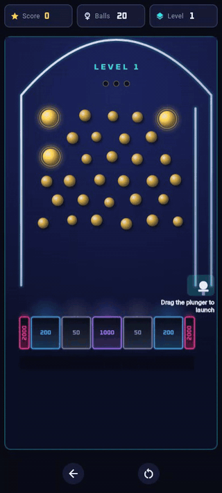
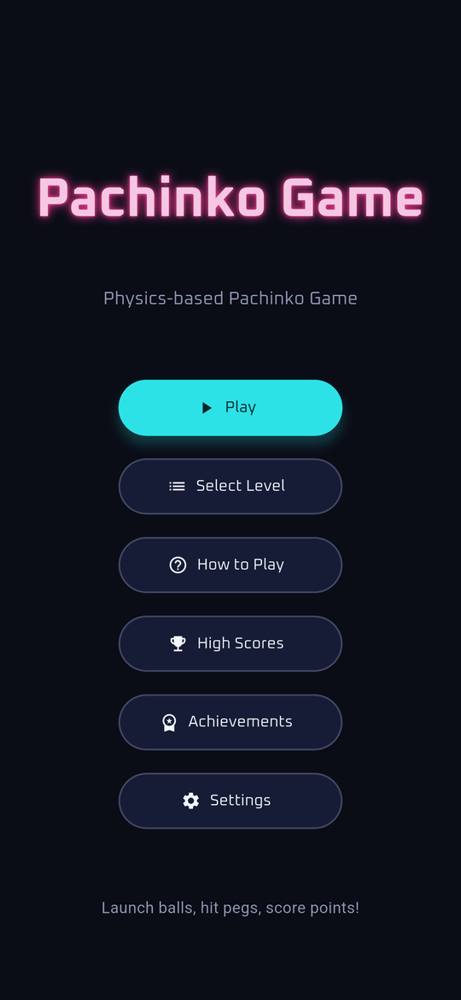
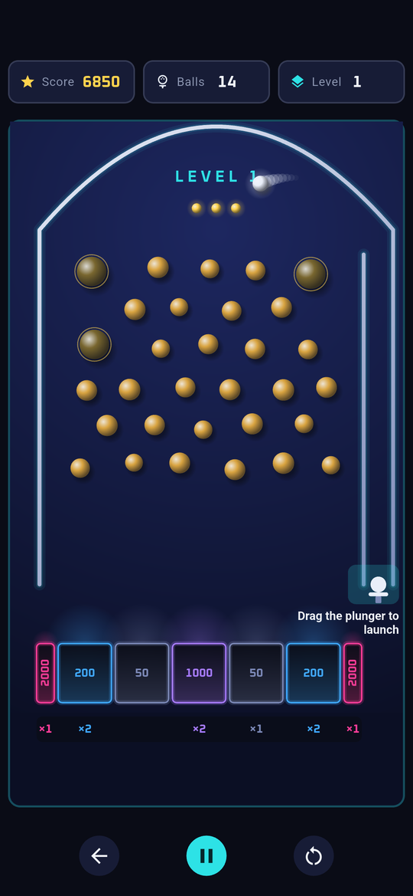
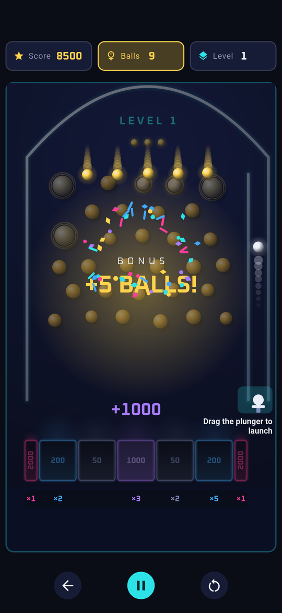
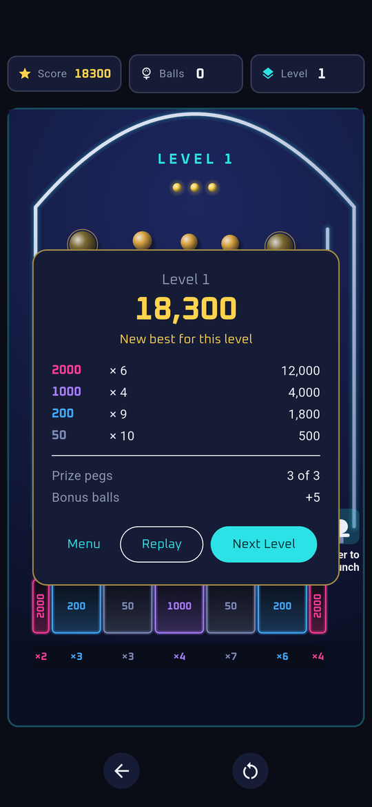
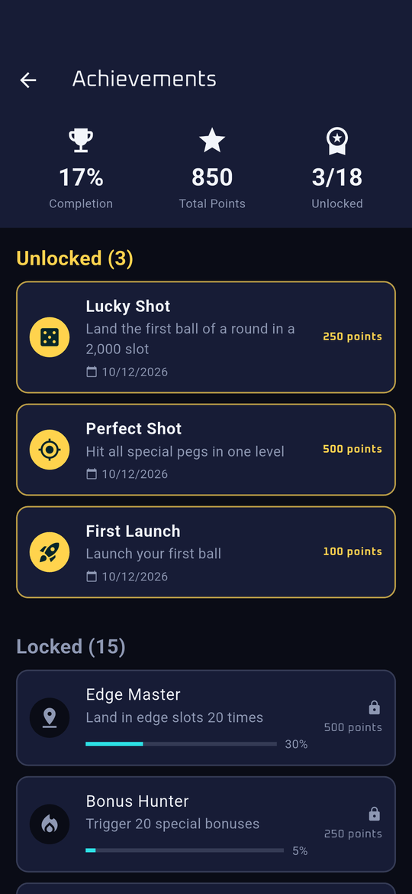
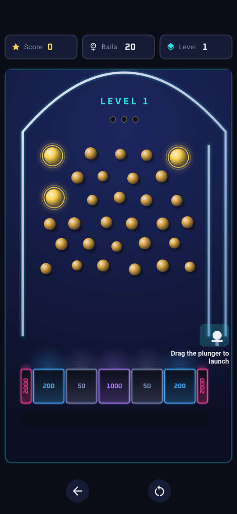
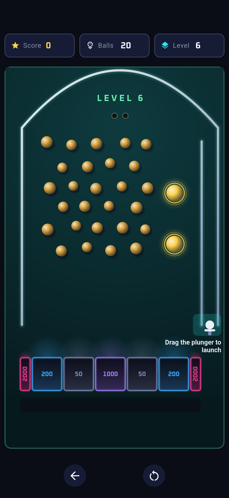
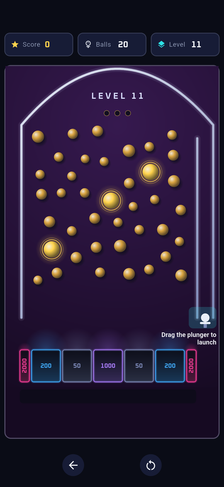
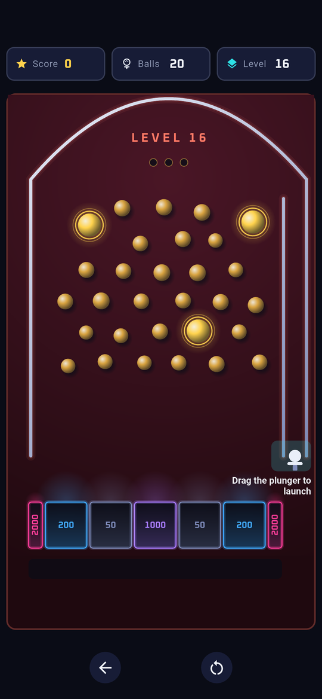

# Pachinko Game

[](https://github.com/frankbria/pachinko/actions/workflows/ci.yml)
[](LICENSE)
[](https://x.com/FrankBria18044)

A pachinko game for Android, built with Flutter. You launch balls up a channel, they ride the dome and fall through a field of brass pins, and where they land is your score. The physics, the board and every effect on it are the game's own code: no game engine, one `Canvas`.

<p align="center">
  
</p>

<p align="center"><em>A round on level 1. All three prize pegs are hit, the bonus drops five more balls, and an achievement unlocks.</em></p>

## Screenshots

<p align="center">
  
  
  
  
  
</p>

The board changes colour every five levels. These are levels 1, 6, 11 and 16:

<p align="center">
  
  
  
  
</p>

## How a round plays

1. **Launch.** Drag the plunger at the bottom right and let go. The launch channel fills with light as the power builds. Power is how you aim: a soft launch drops the ball beside the channel, a full one rides the dome over to the far side.
2. **Fall.** From the top of the channel only the physics moves the ball. It bounces down through the pins, and each pin it hits flashes and sounds.
3. **Score.** The ball lands in one of seven slots:

   | 2000 | 200 | 50 | 1000 | 50 | 200 | 2000 |
   |:----:|:---:|:--:|:----:|:--:|:---:|:----:|

   The two 2,000 slots are against the walls and barely wider than the ball. About one ball in nine lands in one.
4. **Win the bonus.** Each level has two to four gold prize pegs, with a lamp in the dome for each. Hit them all and the bonus drops extra balls from the top: 5 on level 1, one more for every two levels, 15 at most.
5. **Finish.** A round is 20 balls. When the last one lands, the summary shows the level's score, how many balls landed in each kind of slot, and whether it is your best for that level. From there: replay, go on to the next level, or return to the menu.

## What is in the game

- **Levels without end.** Three peg layouts (triangle, random, hexagonal) take turns, and Next Level has no upper limit. The level picker opens any of the first 20 and shows your best score on each.
- **Four colour bands.** Midnight, Lagoon, Plum and Ember, five levels each, then round again.
- **18 achievements**, announced by a toast over whatever screen you are on. Some are milestones (First Launch, Marathon Runner), some take a good round (High Roller: 20,000 in one level), and some take luck or aim (Lucky Shot: the first ball of a round in a 2,000 slot. Combo King: every prize peg on a level with one ball).
- **High scores.** The ten best scores for each level are kept on the device.
- **One ball at a time, or not.** By default the next ball waits for the one in play to land. A setting turns that off, and then you can launch as many as you like. The recording above was made with it off.
- **Sound** for the launch, the pins, the prize pegs, the slots and the bonus.
- **Pause.** The game also pauses itself when the app goes to the background, and waits for you to resume.

## Run it

You need Flutter 3.38.1 (the version CI uses) and, for a phone or an emulator, the Android SDK.

```bash
git clone https://github.com/frankbria/pachinko.git
cd pachinko
flutter pub get

# On a connected Android device or a running emulator
flutter run

# In a browser
flutter run -d chrome
```

To build it:

```bash
# An Android app built the way a release is, without a signing key
flutter build apk --profile

# A web build, written to build/web
flutter build web
```

`flutter build apk --release` is signed with `android/key.properties`, which is not in the repository.

| Platform | Status |
|----------|--------|
| Android | The target. CI builds it on every pull request, and the integration tests run on an emulator. |
| Web | Works, and is used for demos in a browser. Not a release target. |

The repository has no project files for other platforms. `flutter create --platforms=<name> .` adds one.

## Development

```bash
flutter test --exclude-tags golden    # unit and widget tests
flutter test --tags golden            # golden image tests (baselines made on Linux)
flutter analyze                       # must report nothing
dart format lib test integration_test tool test_driver
```

- **Tests.** More than 750 unit and widget tests and 10 golden image tests run on every pull request. 20 integration tests play the game on an Android emulator: `flutter test integration_test -d emulator-5554 --timeout 120s`.
- **CI gates**, in order: analyzer, formatting, generated mocks up to date, tests, coverage of at least 85% on the lines a pull request changes, golden tests, and a profile build of the Android app.
- **Balance.** `flutter test tool/scoring_simulation_test.dart --dart-define=LEVELS=60 --dart-define=ROUNDS=20` plays whole rounds through the real generator, launcher and physics and prints where balls land, how often the bonus triggers and what rounds score. Run it before and after any change to levels, scoring or the bonus.
- **Workflow.** Work on a branch, use conventional commits (`feat:`, `fix:`, `docs:`), and open a pull request to `master`.

[CLAUDE.md](CLAUDE.md) is the full reference: every command, how the game's parts fit together, and the rules new code has to keep.

### Project layout

```
lib/
├── main.dart     # App start and providers
├── models/       # Ball, peg, slot, level, launcher, game state, achievements, high scores
├── services/     # Physics engine, game loop, audio, storage, achievements
├── screens/      # Menu, game, high scores, achievements, settings
├── widgets/      # The board and its painter, effects, round summary, toasts
└── utils/        # Constants and colours, theme, peg layouts
test/             # Unit, widget and golden tests
integration_test/ # Tests and the screenshot script that run on a device
tool/             # The scoring simulation
docs/images/      # The pictures on this page
```

### The pictures on this page

The screenshots come from the `Screenshots` workflow, which runs `integration_test/screenshots.dart` on an Android emulator and uploads what it captures. The recording is the web build played in a browser at a phone's size. [CLAUDE.md](CLAUDE.md) says how to refresh both.

## License

[MIT](LICENSE). The sound effects have their own terms, listed in [`assets/sounds/LICENSING.md`](assets/sounds/LICENSING.md), and the Oxanium typeface is under the [Open Font License](assets/fonts/OFL.txt).

Questions and bug reports: [GitHub Issues](https://github.com/frankbria/pachinko/issues).
